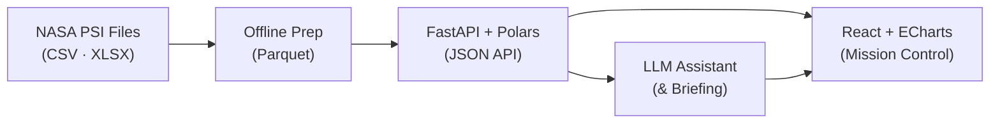

  

    

      
        NASA Physical Sciences Informatics · Mission Control
      
      
        PSI-LENS // 3-Minute Jury Pitch
      
    

    

      Challenge: Flame in Freefall: SI-Powered Fire Safety Insights from Microgravity Combustion Data
    

  

  

    

      Fire in Space Breaks 
      
        Every Earth Intuition
      
    

    

      <strong>PSI-Lens</strong> turns 358 fragmented NASA Physical Sciences Informatics CSV &amp; XLSX experiments into one real-time Mission Control dashboard - from natural-language hypothesis to verified spacecraft fire telemetry.
    

  

  

    

      
358

      
Verified NASA PSI Combustion Runs

    

    

      
6 Missions

      
CFI/FLEX · E-FIELD · Flame Design · SAME-R · SAFFIRE-III

    

    

      
30 Hz + 1 Hz

      
Parquet + Polars Streaming &amp; LLM Briefing

    

  

  

    

      NASA Sources:
      psi.nasa.gov (PSI-159 CFI-G · PSI-39 CFI/FLEX · PSI-10 Flame Design · PSI-100 SAFFIRE-III · PSI-22 E-FIELD · PSI-101 SAME-R) · GRC · NTRS
    

    

      Created By:
      Marcel Bieżuński · Mateusz Frąckowiak · Jakub Grabowski · Jakub Więcław · Bartosz Żelek
    

  

<!--
Opening (0:00–0:25):
In microgravity, there is no buoyancy-driven convection - flames form spheres, burn colder as "cool flames", and spread along spacecraft walls in counterintuitive ways.
NASA's PSI archive holds these real experiments across hundreds of inconsistent CSVs and Excel sheets. We built PSI-Lens so researchers and mission engineers can explore 358 runs across 6 NASA investigations in seconds.
-->

---
title: Microgravity Combustion & Mission Overview
---

  

    <h1>Microgravity Combustion &amp; Mission Overview</h1>
    

      Unified mission-control dashboard spotlighting featured ISS experiments and Cygnus OA-7 SAFFIRE-III runs right on entry.
    

  

  

    
  

<!--
Slide 2 (0:25–0:50):
When you open PSI-Lens, you immediately see our featured Mission Overview cards alongside the full filtered experiment catalog - dark aerospace ergonomics engineered for fast exploration without hunting through spreadsheets.
-->

---
title: Natural-Language Scenario Filter Assistant
---

  

    <h1>Natural-Language Scenario Filter Assistant</h1>
    

      Translate plain-English combustion hypotheses into validated O₂, pressure, fuel, and mission filters with live control highlights.
    

  

  

    
  

<!--
Slide 3 (0:50–1:15):
Instead of remembering exact NASA dataset codes, a user types a scenario - e.g., elevated oxygen or low spacecraft cabin pressure. Our assistant emits a validated filter state, flashes changed controls in the UI, and preserves manual control at every step.
-->

---
title: Atmospheric Regime & Parameter Explorer
---

  

    <h1>Atmospheric Regime &amp; Parameter Explorer</h1>
    

      Visualize verified case density across oxygen and pressure envelopes alongside ISS and exploration spacecraft reference regimes.
    

  

  

    
  

<!--
Slide 4 (1:15–1:40):
Beyond the table, the Regime Explorer maps real experiment coverage over O2% vs. Pressure, Z_st flammability distributions, and NASA context tags - never inventing unmeasured data points or fake safety contours.
-->

---
title: Multi-Run Flame Spread Comparison
---

  

    <h1>Multi-Run Flame Spread Comparison</h1>
    

      Pin compatible experiments to inspect synchronized telemetry curves, ignition behavior, and chamber differences side by side.
    

  

  

    
  

<!--
Slide 5 (1:40–2:00):
Users can pin runs right from the catalog into a comparison queue and overlay synchronized sensors across chamber pressures or oxygen concentrations in one click.
-->

---
title: Interactive Time-Series & Scatter Telemetry
---

  

    <h1>Interactive Time-Series &amp; Scatter Telemetry</h1>
    

      Switch smoothly between dual-unit time-series traces and paired X/Y scatter correlations from pre-loaded Parquet JSON.
    

  

  

    
  

<!--
Slide 6 (2:00–2:25):
Inside any case view, dual-unit ECharts panels keep temperatures, radiometer heat flux, and droplet diameters cleanly separated, while instant Line/Scatter toggling reuses in-memory JSON with zero extra API round-trips.
-->

---
title: SAFFIRE-III Spacecraft Fire Telemetry & AI Briefing
---

  

    <h1>SAFFIRE-III Spacecraft Fire Telemetry &amp; AI Briefing</h1>
    

      Dedicated Cygnus OA-7 fire analysis combining 30 Hz thermopile arrays, flame-arrival ordering, and 1 Hz downlink with an AI summary.
    

  

  

    
  

<!--
Slide 7 (2:25–2:50):
Our flagship spotlight is NASA PSI-100 SAFFIRE-III aboard Cygnus OA-7: we synchronize 30 Hz chamber thermocouples and radiometers with 1 Hz spacecraft smoke-detector downlink and a focus-aware LLM mission briefing grounded strictly in measured peaks.
-->

---
title: Pipeline & Architecture
---

  

    <h1>Scientific Data Integrity at Mission-Control Speed</h1>
    

      Pre-curated Parquet + Polars pipelines power sub-second JSON responses while keeping every chart strictly faithful to NASA measurements.
    

  

  

  

  

    

      
Parquet + Polars

      
Zero per-request CSV parsing

    

    

      
Real Physics Units

      
Nulls preserved · dual axes

    

    

      
SAFFIRE-III Bespoke

      
30 Hz + 1 Hz Cygnus sync

    

    

      
Open Live Explorer

      
psi-lens // ready to demo

    

  

<!--
Closing (2:50–3:00):
Under the hood: offline ETL normalizes NASA CSV/XLSX into Parquet, FastAPI + Polars serve typed JSON in milliseconds, and React + Apache ECharts render crisp telemetry with zero fabricated safety claims. Thank you - happy to open the live dashboard for Q&A!
-->
